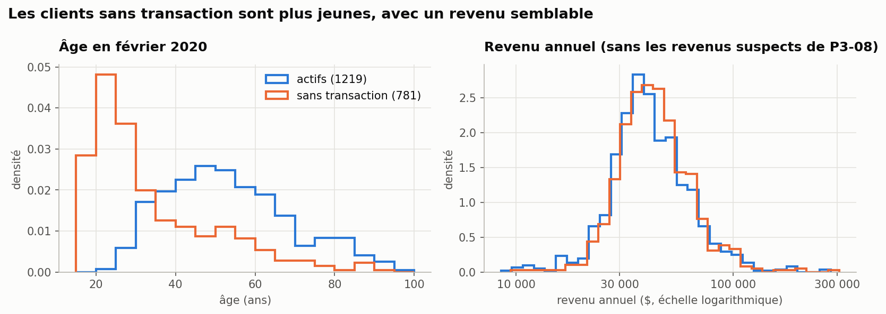

# P5-01 : Décrire la population des clients

## Pourquoi cette étape ?

Avant de regrouper les clients en profils, il faut connaître la population : âge, genre, revenus, dette, score de crédit. Il faut aussi savoir si les 781 clients sans transaction (P2-04) ressemblent aux clients actifs, car ils seront absents des profils.

Le critère de fin du ticket est : **tableaux et graphiques commentés**.

## Où est le code ?

- `src/profiles.py` : `describe_population`.
- `notebooks/05_profils_clients.ipynb` : section P5-01.

`describe_population(df_users, active_ids)` sépare les clients en « actifs » et « sans transaction », puis donne pour chaque groupe le nombre de clients et les médianes. L'âge est celui de février 2020 (`current_age`, P2-12), car il décrit la population à la date des fichiers.

## Résultats obtenus

| Mesure | Actifs | Sans transaction |
| --- | --- | --- |
| Clients | 1 219 | 781 |
| Âge médian (février 2020) | 51 ans | 28 ans |
| Part de femmes | 51,0 % | 50,4 % |
| Revenu annuel médian | 40 012 $ | 41 940 $ |
| Dette médiane | 51 984 $ | 65 126 $ |
| Score de crédit médian | 715 | 705 |
| Cartes de crédit (médiane) | 4 | 2 |
| Revenus suspects (P3-08) | 11 | 4 |

**Critère de fin validé.**

## Ce que ces résultats veulent dire

- Les clients sans transaction sont beaucoup plus jeunes : la plupart ont entre 15 et 35 ans.
- Leur revenu est semblable à celui des actifs, mais leur dette est plus élevée et ils ont moins de cartes.
- Les profils de la phase 5 décrivent donc surtout des clients d'âge moyen. Ils ne disent rien des jeunes clients, qui sont nombreux parmi les clients sans transaction.

## Ce que cette étape ne fait PAS

- Elle ne construit pas les profils : ce sont P5-02 à P5-05.
