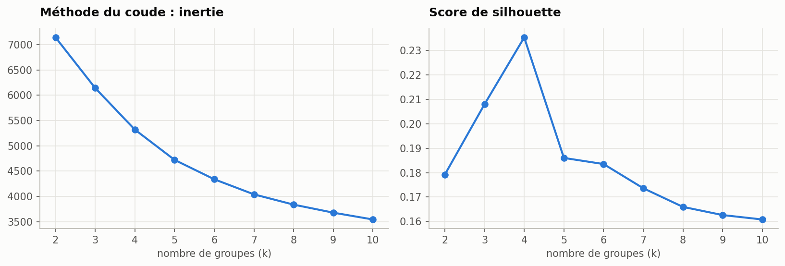

# P5-04 : Segmenter les clients avec K-means

## Pourquoi cette étape ?

K-means regroupe les clients qui se ressemblent sur les sept variables de P5-03. Il faut lui donner le nombre de groupes : on teste de 2 à 10 groupes et on choisit avec deux critères.

Le critère de fin du ticket est : **nombre de groupes justifié**.

## Où est le code ?

- `src/profiles.py` : `scan_kmeans` et `fit_profiles`.
- `notebooks/05_profils_clients.ipynb` : section P5-04.

| Fonction | Rôle |
| --- | --- |
| `scan_kmeans(x)` | Lance K-means de 2 à 10 groupes (20 départs chacun) et calcule l'inertie et le score de silhouette. |
| `fit_profiles(x, k)` | Lance K-means avec k groupes et renumérote les groupes du plus grand (1) au plus petit. |

- **Inertie** : somme des distances des clients au centre de leur groupe. Elle baisse toujours quand on ajoute des groupes. On cherche le « coude », où elle cesse de baisser fortement.
- **Score de silhouette** : de -1 à 1. Plus il est haut, plus chaque client est proche de son groupe et loin du groupe voisin.

## Résultats obtenus

| Groupes | Inertie | Silhouette |
| --- | --- | --- |
| 2 | 7 141 | 0,179 |
| 3 | 6 141 | 0,208 |
| **4** | **5 320** | **0,235** |
| 5 | 4 723 | 0,186 |
| 6 | 4 340 | 0,184 |
| 7 | 4 042 | 0,174 |
| 8 | 3 839 | 0,166 |
| 9 | 3 681 | 0,163 |
| 10 | 3 546 | 0,161 |

## Le choix : 4 groupes

- Le score de silhouette est le plus haut avec 4 groupes (0,235), nettement devant 3 et 5 groupes.
- L'inertie n'a pas de coude net, mais sa baisse ralentit après 4 groupes.
- Avec 4 groupes, le plus petit compte encore 63 clients : assez pour le décrire.

Tailles des groupes : 686, 321, 138 et 63 clients.

**Critère de fin validé.**

## Limite

Un score de silhouette de 0,235 indique des groupes réels, mais pas très séparés : beaucoup de clients sont entre deux profils. Les profils décrivent des tendances, pas des catégories étanches.
