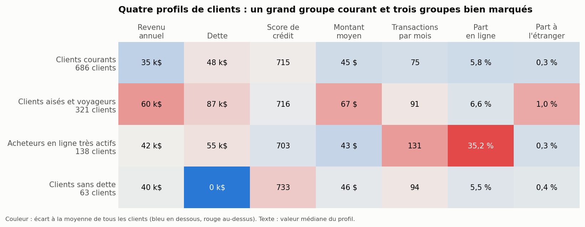

# P5-07 : Visuel clé des profils (Q1)

Statut : à relire par un autre membre (critère de fin de P5-07).

## Comment le lire

- Une ligne par profil, du plus grand au plus petit, avec son nombre de clients.
- Une colonne par variable de la segmentation (P5-03).
- **La couleur** montre l'écart à la moyenne de tous les clients : bleu en dessous, rouge au-dessus, gris proche de la moyenne. Plus la couleur est foncée, plus l'écart est grand.
- **Le texte** donne la valeur médiane du profil.

## Le message

Un grand groupe de clients courants, et trois groupes bien marqués : les clients aisés et voyageurs (revenu, montant moyen et part à l'étranger en rouge), les acheteurs en ligne très actifs (part en ligne et fréquence en rouge) et les clients sans dette (dette en bleu foncé).

## Conformité à la charte (P1-10)

- Le titre annonce le message.
- Carte de chaleur divergente bleu, gris, rouge, lisible par les personnes daltoniennes.
- Texte en noir, ou en blanc sur les cases les plus foncées.
- Nombres à la française.

Le visuel est créé par `notebooks/05_profils_clients.ipynb` (section P5-07) et repris dans le tableau de bord (page « Profils de clients »).
