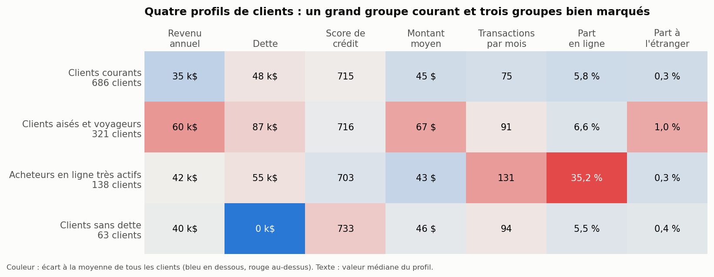

# P5-08 : Section « Profils de clients » du rapport (Q1)

Statut : à relire par un autre membre (critère de fin de P5-08). Tous les chiffres viennent de `notebooks/05_profils_clients.ipynb`.

## Question

Q1 : quels sont les principaux profils de clients ?

## Méthode

- **Population.** 2 000 clients, dont 1 219 actifs (au moins une transaction) et 781 sans transaction. Les profils portent sur les clients actifs : les autres n'ont pas de comportement à résumer.
- **Variables.** Une ligne par client actif, avec sept variables choisies pour être peu liées entre elles (corrélation de Spearman inférieure à 0,5) :
  - trois financières : revenu annuel, dette, score de crédit ;
  - quatre de dépense : montant moyen des achats, transactions par mois, part en ligne, part à l'étranger.
- **Choix éthique.** Le genre et l'âge ne servent pas à former les groupes. Ils servent seulement à les décrire.
- **Préparation.** Les 11 clients au revenu suspect (P3-08) sont écartés. Les variables asymétriques passent par log(1 + x), puis toutes sont mises à la même échelle.
- **Segmentation.** K-means de 2 à 10 groupes. Le score de silhouette est le plus haut avec 4 groupes (0,235).
- **Stabilité.** Relancée avec d'autres graines et sur des échantillons de 80 % des clients, la segmentation retrouve presque les mêmes groupes (indice de Rand ajusté moyen de 0,972).

## Profils obtenus

| Profil | Clients | Ce qui le distingue | Valeurs médianes |
| --- | --- | --- | --- |
| Clients courants | 686 | Proches de la moyenne sur toutes les variables | Revenu de 34 928 $, 75 transactions par mois, achat moyen de 45,02 $ |
| Clients aisés et voyageurs | 321 | Revenu, montant moyen et part à l'étranger élevés | Revenu de 59 872 $, achat moyen de 67,17 $, part à l'étranger de 0,010 |
| Acheteurs en ligne très actifs | 138 | Part en ligne et fréquence élevées | Part en ligne de 0,352, 131 transactions par mois |
| Clients sans dette | 63 | Dette nulle | Score de crédit de 733, le plus haut |

**Réponse à Q1.** Les clients actifs forment quatre profils : une majorité de clients courants, et trois groupes plus petits définis par la richesse et les voyages, par l'achat en ligne, ou par l'absence de dette. L'âge et le nombre de cartes sont les mêmes d'un profil à l'autre.

**Lien avec la détection (P7-06).** Les acheteurs en ligne très actifs (1,327 %) et les clients aisés et voyageurs (1,212 %) ont plus de transactions signalées que les clients courants (0,794 %).

## Limites

- Les profils résument dix ans d'activité : ils ne montrent pas les changements d'habitudes d'un client.
- Les informations des clients datent de février 2020 (P2-12) : revenu, dette et score de crédit peuvent avoir changé depuis 2010.
- Les groupes sont réels mais peu séparés (silhouette de 0,235) : beaucoup de clients sont entre deux profils.
- Les jeunes clients, nombreux parmi les clients sans transaction (âge médian de 28 ans), sont absents des profils.
