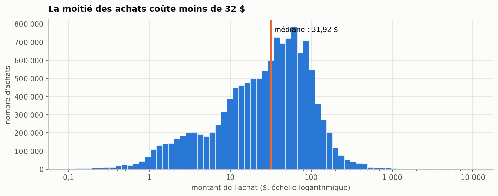

# P6-01 : Analyser les montants

## Pourquoi cette étape ?

Connaître la distribution des montants donne la référence pour repérer un montant inhabituel (P4-04, règle R03). Il faut aussi comprendre deux cas particuliers : les montants ronds et les remboursements.

Le critère de fin du ticket est : **graphiques et constats chiffrés**.

## Où est le code ?

`notebooks/06_analyse_exploratoire.ipynb`, section P6-01. Les taux par famille utilisent `rate_table` de `src/comparisons.py`.

## Résultats obtenus

| Mesure | Valeur |
| --- | --- |
| Achats (montant positif) | 12 635 227 |
| Remboursements (montant négatif) | 660 049 |
| Montants nuls | 10 639 |
| Achat médian | 31,92 $ |
| Achat moyen | 50,60 $ |
| Quantiles 1 % et 99 % des achats | 0,63 $ et 324,52 $ |
| Quantile 99,9 % et maximum | 906,87 $ et 6 820,20 $ |
| Achats de plus de 1 000 $ | 9 185 |
| Total des achats | 639 354 565 $ |
| Total des remboursements | -67 519 042 $ (médiane : -79,00 $) |

| Famille | Remboursements | Achats sans centimes |
| --- | --- | --- |
| Industrie et fabrication | 28,36 % | 28,83 % |
| Voyage et hébergement | 27,45 % | 27,92 % |
| Alimentation | 9,13 % | 9,92 % |
| Transport, carburant et automobile | 9,03 % | 9,85 % |
| Maison, jardin et électronique | 1,42 % | 2,41 % |
| Services publics et télécommunications | 0,73 % | 1,70 % |
| Services professionnels et financiers | 0,00 % | 80,57 % |
| Six autres familles | 0,00 % | environ 1 % |

## Constats

- La moitié des achats coûte moins de 31,92 $. La moyenne (50,60 $) est plus haute : quelques gros achats la tirent vers le haut.
- La plupart des achats se situent entre 10 et 100 $.
- Les remboursements (4,96 % des transactions) n'existent que dans six familles, surtout l'industrie (28,36 %) et le voyage (27,45 %).
- Les achats sans centimes font 10,15 % des transactions, et 80,57 % en services professionnels et financiers : un montant rond est normal dans certains commerces. C'est pourquoi la règle « montant rond » ne vaut qu'un point (P7-01).

**Critère de fin validé.**
