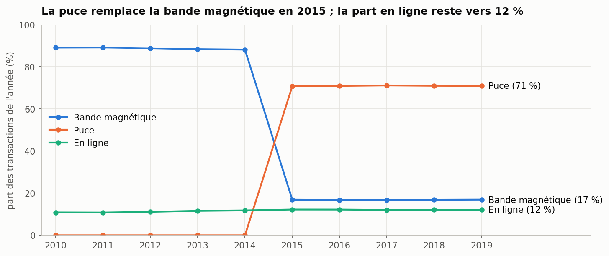

# P6-02 : Analyser les canaux de paiement

## Pourquoi cette étape ?

Le canal de paiement change le risque : le paiement en ligne se fait sans carte physique (P2-17 : taux de fraude de 0,841 % en ligne contre 0,099 % par puce). Il faut savoir comment les clients paient et si cela change dans le temps.

Le critère de fin du ticket est : **graphique commenté**.

## Où est le code ?

`notebooks/06_analyse_exploratoire.ipynb`, section P6-02.

## Résultats obtenus

| Canal | Transactions |
| --- | --- |
| Bande magnétique | 6 967 185 |
| Puce | 4 780 818 |
| En ligne | 1 557 912 |

| Année | Bande magnétique | Puce | En ligne |
| --- | --- | --- | --- |
| 2010 | 89,1 % | 0,0 % | 10,9 % |
| 2014 | 88,2 % | 0,0 % | 11,8 % |
| 2015 | 16,9 % | 70,8 % | 12,2 % |
| 2019 | 17,0 % | 71,0 % | 12,1 % |

## Constats

- De 2010 à 2014, la puce n'existe pas dans les données : environ 89 % des transactions se font par bande magnétique.
- En 2015, le changement est brutal : la puce passe à 70,8 % et la bande magnétique tombe à 16,9 %. Ensuite, les parts ne bougent presque plus.
- La part en ligne monte lentement, de 10,9 % à 12,1 %.
- Conséquence pour la détection : une analyse par canal doit séparer les années avant et après 2015.

**Critère de fin validé.**
