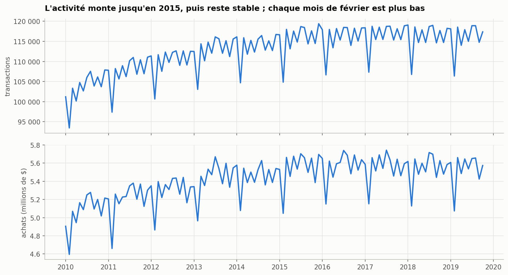
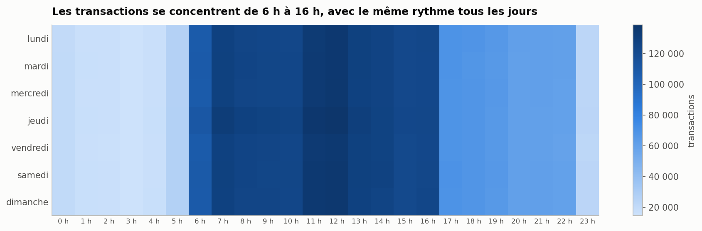

# P6-03 : Analyser l'évolution dans le temps (Q6)

## Pourquoi cette étape ?

Q6 demande comment les comportements évoluent dans le temps. Il faut aussi connaître les rythmes normaux (mois, jour, heure) pour juger si une transaction tombe à un moment inhabituel.

Le critère de fin du ticket est : **graphiques commentés**.

## Où est le code ?

`notebooks/06_analyse_exploratoire.ipynb`, section P6-03.

## Résultats obtenus

| Année | Transactions | Achats ($) | Clients actifs | Achat moyen |
| --- | --- | --- | --- | --- |
| 2010 | 1 240 880 | 60 822 378 | 1 137 | 51,7 $ |
| 2013 | 1 352 808 | 65 186 301 | 1 190 | 50,8 $ |
| 2016 | 1 392 117 | 66 831 179 | 1 210 | 50,5 $ |
| 2017 | 1 399 308 | 66 681 437 | 1 209 | 50,2 $ |
| 2019 (janvier à octobre) | 1 159 966 | 55 316 451 | 1 206 | 50,2 $ |

## Constats

- **Tendance.** Le nombre de transactions monte jusqu'en 2015, puis reste stable. Le nombre de clients actifs suit la même courbe (1 137 en 2010, 1 210 en 2016). L'achat moyen baisse un peu (de 51,7 $ à 50,2 $).
- **Mois.** Le mois le plus faible est février 2010 (93 470 transactions) et le plus fort décembre 2015 (119 396). Février est chaque année le plus bas (103 135 en moyenne), car il compte moins de jours.
- **Jour.** Aucun effet du jour de la semaine : de 1 895 372 (vendredi) à 1 918 666 (jeudi).
- **Heure.** Forte activité de 6 h à 16 h. L'heure la plus chargée est 12 h (953 498 transactions), la plus calme 3 h (103 478). La nuit (0 h à 5 h 59) compte 5,8 % des transactions.

**Critère de fin validé.**
