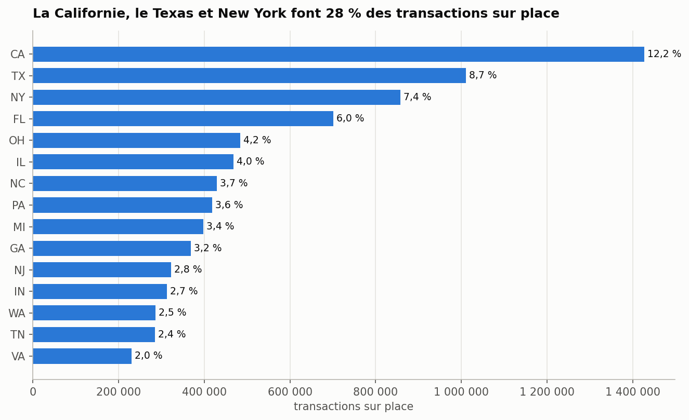

# P6-04 : Analyser la géographie (Q6)

## Pourquoi cette étape ?

Le lieu d'achat aide à repérer une carte copiée : un achat à l'étranger ou dans un pays nouveau pour le client sort de ses habitudes. Il faut d'abord savoir où les clients achètent normalement.

Le critère de fin du ticket est : **carte ou graphique commenté**.

## Où est le code ?

`notebooks/06_analyse_exploratoire.ipynb`, section P6-04. Le lieu vient de P3-07 (`is_online`, `is_foreign`, `merchant_state_clean`, `merchant_country`).

## Résultats obtenus

| Lieu | Transactions | Part des transactions | Part du montant | Achat moyen |
| --- | --- | --- | --- | --- |
| Sur place aux États-Unis | 11 653 209 | 87,58 % | 84,88 % | 49,33 $ |
| En ligne | 1 563 700 | 11,75 % | 14,35 % | 59,04 $ |
| À l'étranger | 89 006 | 0,67 % | 0,77 % | 60,69 $ |

| Pays étranger | Transactions |
| --- | --- |
| Mexique | 27 401 |
| Canada | 10 647 |
| Italie | 7 081 |
| Royaume-Uni | 4 482 |
| Allemagne | 3 025 |

## Constats

- Presque 9 transactions sur 10 se font sur place aux États-Unis.
- Les achats en ligne et à l'étranger sont plus chers en moyenne que les achats sur place.
- 52 États apparaissent. Les 5 premiers en font 38,4 % : Californie (12,2 %), Texas (8,7 %), New York (7,4 %), Floride (6,0 %) et Ohio (4,2 %).
- 147 pays étrangers apparaissent, dominés par le Mexique et le Canada, les deux voisins des États-Unis.

**Critère de fin validé.**
