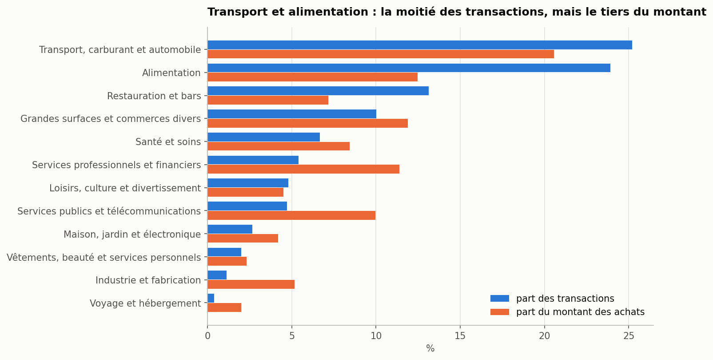
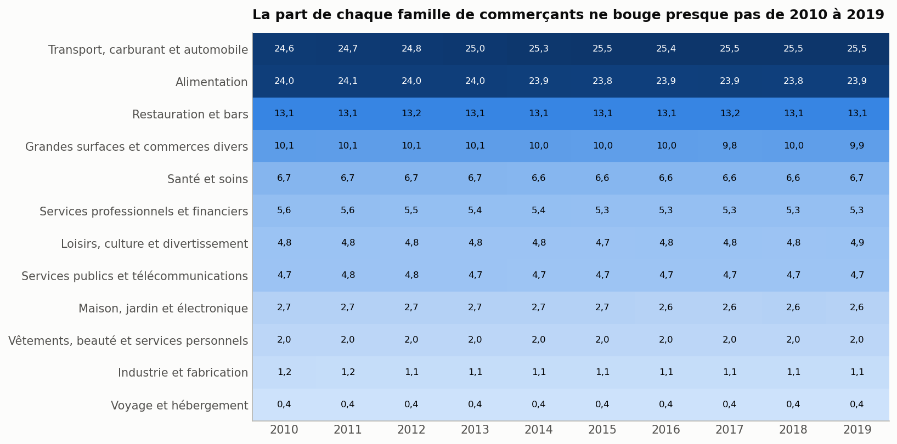

# P6-05 : Analyser les catégories de commerçants (Q6)

## Pourquoi cette étape ?

Le type de commerce explique beaucoup de comportements : un plein d'essence et un billet d'avion n'ont ni le même montant ni le même risque. Les familles de P3-05 permettent de comparer 12 groupes au lieu de 109 codes.

Le critère de fin du ticket est : **graphiques commentés**.

## Où est le code ?

`notebooks/06_analyse_exploratoire.ipynb`, section P6-05.

## Résultats obtenus

| Famille | Part des transactions | Part du montant | Achat moyen |
| --- | --- | --- | --- |
| Transport, carburant et automobile | 25,19 % | 20,55 % | 43,08 $ |
| Alimentation | 23,92 % | 12,46 % | 27,56 $ |
| Restauration et bars | 13,14 % | 7,15 % | 26,17 $ |
| Grandes surfaces et commerces divers | 10,01 % | 11,90 % | 57,10 $ |
| Santé et soins | 6,66 % | 8,42 % | 60,79 $ |
| Services professionnels et financiers | 5,40 % | 11,37 % | 102,76 $ |
| Loisirs, culture et divertissement | 4,80 % | 4,50 % | 45,08 $ |
| Services publics et télécommunications | 4,71 % | 9,97 % | 102,45 $ |
| Maison, jardin et électronique | 2,65 % | 4,17 % | 76,71 $ |
| Vêtements, beauté et services personnels | 2,00 % | 2,32 % | 55,78 $ |
| Industrie et fabrication | 1,13 % | 5,17 % | 306,26 $ |
| Voyage et hébergement | 0,39 % | 2,00 % | 338,70 $ |

## Constats

- Le transport et l'alimentation font ensemble près de la moitié des transactions, mais seulement 20,55 % et 12,46 % du montant : ce sont des achats fréquents et peu chers.
- À l'inverse, les services professionnels et financiers, les services publics et l'industrie pèsent plus en montant qu'en nombre.
- Les achats les plus chers sont en voyage et hébergement (338,70 $ en moyenne) et en industrie et fabrication (306,26 $).
- Codes les plus fréquents : épiceries et supermarchés (1 592 584), magasins d'alimentation divers (1 460 875), stations-service (1 424 711). En montant, les transferts d'argent arrivent en tête (53 158 516 $).
- La part de chaque famille ne bouge presque pas de 2010 à 2019 : 0,91 point d'écart au plus (transport).

**Critère de fin validé.**
