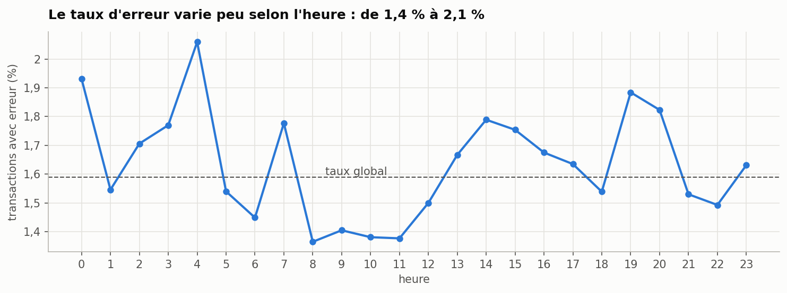

# P6-06 : Analyser les erreurs et les refus

## Pourquoi cette étape ?

Une erreur (PIN, CVV, solde insuffisant...) bloque la transaction. Certaines erreurs sont banales, d'autres peuvent signaler une tentative de fraude. Il faut savoir où et quand elles arrivent, et repérer les cartes aux erreurs répétées.

Le ticket demande aussi, pour toute comparaison chiffrée de la phase, la **taille de l'écart** et non seulement la significativité : avec 13 millions de lignes, presque tout est significatif.

Le critère de fin du ticket est : **tableau et constats**.

## Où est le code ?

- `src/comparisons.py` : `rate_table`, `chi2_test`, `effect_label`.
- `notebooks/06_analyse_exploratoire.ipynb`, section P6-06.

| Fonction | Rôle |
| --- | --- |
| `rate_table(df, by, flag)` | Taux d'une colonne 0/1 par groupe, avec l'écart au taux global en points et le rapport (2 = deux fois plus). |
| `chi2_test(df, col, flag)` | Test du khi-deux et taille d'effet : V de Cramér (0 = aucun lien, 1 = lien parfait). |
| `effect_label(v)` | Lecture de la taille d'effet : négligeable (moins de 0,1), faible (de 0,1 à 0,3), moyen (de 0,3 à 0,5), fort (0,5 ou plus). |

## Résultats obtenus

| Canal | Taux d'erreur | Rapport au taux global |
| --- | --- | --- |
| En ligne | 2,283 % | 1,44 |
| Puce | 1,512 % | 0,95 |
| Bande magnétique | 1,486 % | 0,94 |

Taux global : 1,589 % (échecs d'authentification : 0,406 %). Par famille, de 1,012 % (restauration, rapport de 0,64) à 2,862 % (services professionnels et financiers, rapport de 1,80). Par heure, d'environ 1,4 % (de 8 h à 11 h) à 2,059 % (4 h).

| Type d'erreur | Puce | En ligne | Bande magnétique |
| --- | --- | --- | --- |
| Solde insuffisant | 1,028 % | 0,793 % | 1,006 % |
| Panne technique | 0,202 % | 0,199 % | 0,199 % |
| Mauvais PIN | 0,278 % | 0,000 % | 0,275 % |
| Mauvais CVV | 0,000 % | 0,400 % | 0,000 % |
| Mauvais numéro | 0,000 % | 0,509 % | 0,000 % |
| Mauvaise expiration | 0,000 % | 0,404 % | 0,000 % |
| Mauvais code postal | 0,009 % | 0,000 % | 0,010 % |

| Variable comparée au taux d'erreur | Khi-deux | p-valeur | V de Cramér | Lecture |
| --- | --- | --- | --- | --- |
| Canal | 5 446,3 | < 0,001 | 0,020 | négligeable |
| Famille de commerçants | 16 705,3 | < 0,001 | 0,035 | négligeable |
| Heure | 2 545,4 | < 0,001 | 0,014 | négligeable |
| Jour de la semaine | 5,3 | 0,504 | 0,001 | négligeable |
| Lieu | 5 336,7 | < 0,001 | 0,020 | négligeable |

**Cartes aux erreurs répétées.** 4 017 des 4 071 cartes actives ont eu au moins une erreur (médiane de 36 par carte, maximum de 1 226). 12 cartes ont eu au moins 3 échecs d'authentification en 24 heures, pour 34 transactions.

## Constats

- Le taux d'erreur est plus haut en ligne, en services professionnels et financiers, et la nuit (4 h).
- Ces écarts sont significatifs, mais leur taille est négligeable (V de Cramér de 0,035 au plus) : l'erreur dépend peu du contexte.
- Les types d'erreur dépendent du canal : CVV, numéro et expiration n'arrivent qu'en ligne, le PIN qu'avec une carte physique.
- Les erreurs sont fréquentes et réparties sur presque toutes les cartes : une erreur seule n'est pas un signal fort. Les échecs répétés en 24 heures sont rares (12 cartes).

**Critère de fin validé.**
