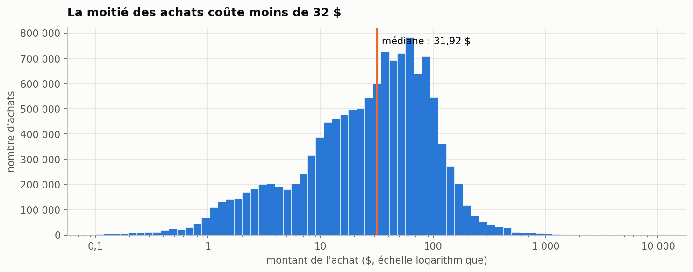
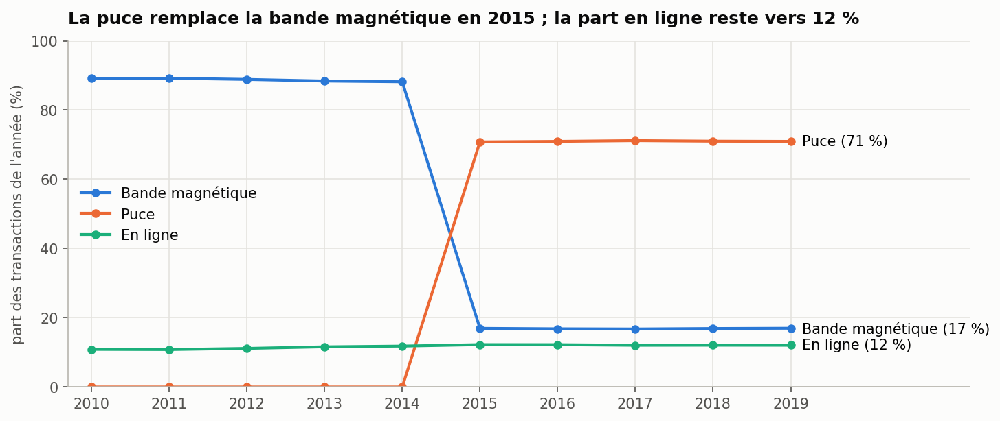
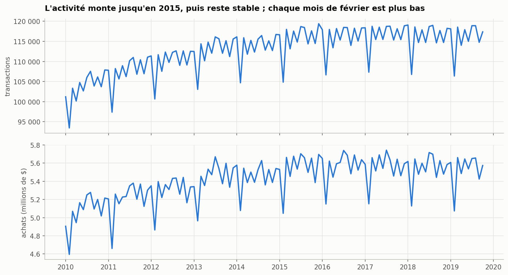
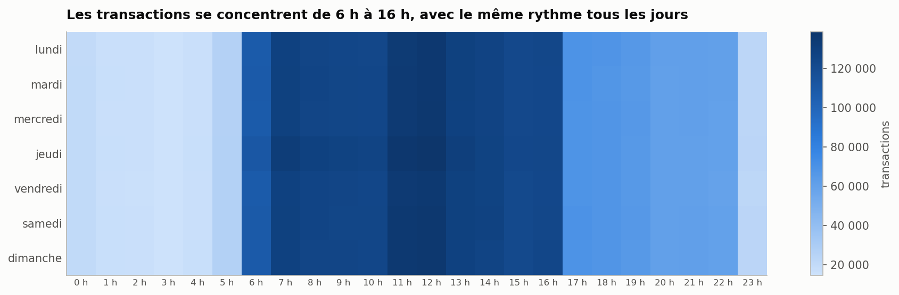
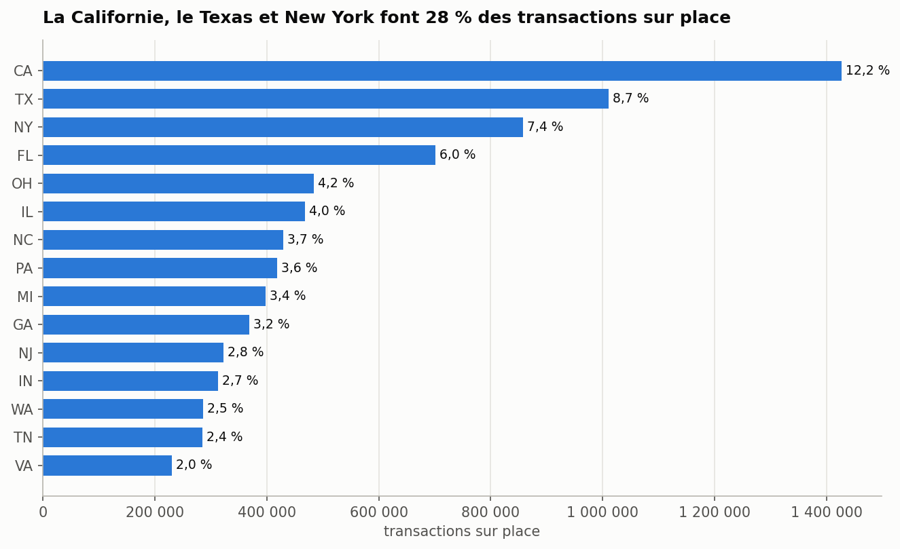
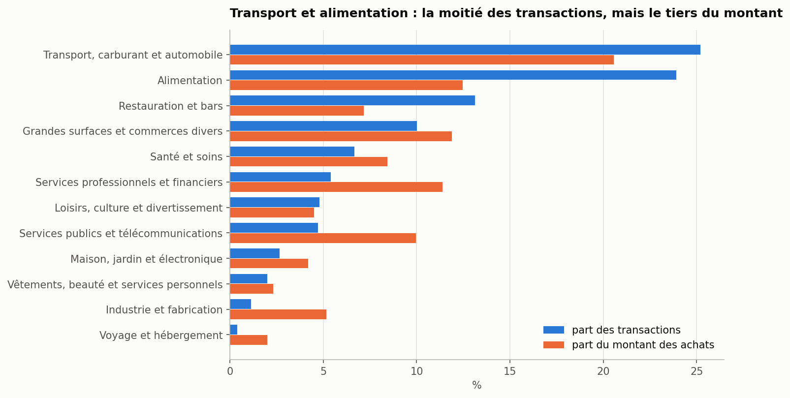
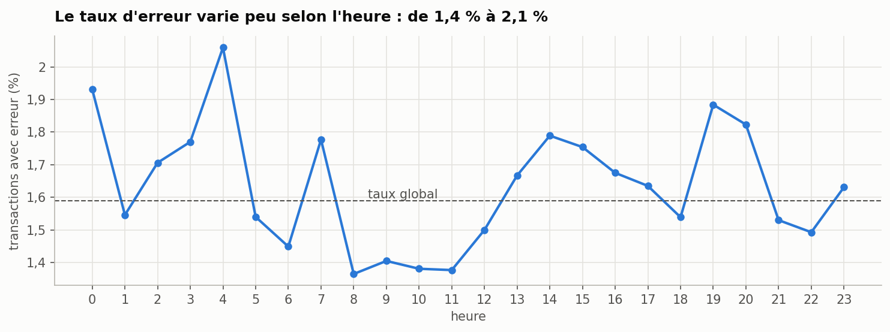

# P6-09 : Section « Comportements » du rapport (Q2, Q6)

Statut : à relire par un autre membre (critère de fin de P6-09). Tous les chiffres viennent de `notebooks/06_analyse_exploratoire.ipynb`.

## Questions

- Q2 : quels sont les comportements transactionnels des clients ?
- Q6 : comment ces comportements varient-ils selon le temps, le lieu et la catégorie de commerçant ?

## Les constats principaux

### 1. La plupart des achats sont petits

La moitié des 12 635 227 achats coûte moins de 31,92 $, et 1 % dépasse 324,52 $. La moyenne (50,60 $) est tirée vers le haut par quelques gros achats.

### 2. La puce remplace la bande magnétique en 2015

De 2010 à 2014, environ 89 % des transactions se font par bande magnétique. En 2015, la puce passe d'un coup à 70,8 %. La part en ligne reste stable, autour de 11 à 12 %.

### 3. L'activité monte jusqu'en 2015, puis se stabilise

Les transactions passent de 1 240 880 en 2010 à 1 399 308 en 2017, avec plus de clients actifs (de 1 137 à 1 210). Février est chaque année le mois le plus bas.

### 4. Les achats se font de jour, au même rythme toute la semaine

Forte activité de 6 h à 16 h (pic à 12 h : 953 498 transactions). La nuit ne compte que 5,8 % des transactions. Le jour de la semaine ne change presque rien.

### 5. Presque tout se passe sur place aux États-Unis

87,58 % des transactions sur place aux États-Unis, 11,75 % en ligne, 0,67 % à l'étranger (surtout au Mexique et au Canada). Les trois premiers États (Californie, Texas, New York) font 28 % des transactions sur place.

### 6. Transport et alimentation dominent en nombre, pas en montant

Ces deux familles font près de la moitié des transactions, mais 20,55 % et 12,46 % du montant. Les achats les plus chers sont en voyage (338,70 $ en moyenne) et en industrie (306,26 $). Ces parts ne changent presque pas en dix ans.

### 7. Les erreurs sont fréquentes mais peu liées au contexte

1,589 % des transactions ont une erreur, un peu plus en ligne (2,283 %). Les tailles d'effet sont négligeables (V de Cramér de 0,035 au plus). CVV, numéro et expiration ne posent problème qu'en ligne.

### 8. Les profils se distinguent surtout par l'achat en ligne

Les acheteurs en ligne très actifs font 35,12 % de leurs transactions en ligne, contre 5,9 % à 8,65 % pour les autres profils (lien de taille moyenne : V de Cramér de 0,335). La nuit, le week-end et les erreurs varient très peu d'un profil à l'autre.

## Réponses

- **Q2.** Le client type fait de petits achats fréquents, de jour, sur place aux États-Unis, surtout en transport et en alimentation. Un achat sur huit environ se fait en ligne, et moins d'un sur cent à l'étranger.
- **Q6.** Dans le temps : hausse jusqu'en 2015, puis stabilité, et passage brutal à la puce en 2015. Selon le lieu : très peu d'achats à l'étranger, plus chers en moyenne. Selon la catégorie : la répartition entre familles est stable sur dix ans.

## Ce que cela change pour la détection

- Ce qui est rare devient un signal : achat à l'étranger, nouveau pays, achat de nuit, gros montant pour la famille ou pour le client.
- Un montant rond et une erreur isolée sont trop fréquents pour signaler une fraude seuls.
