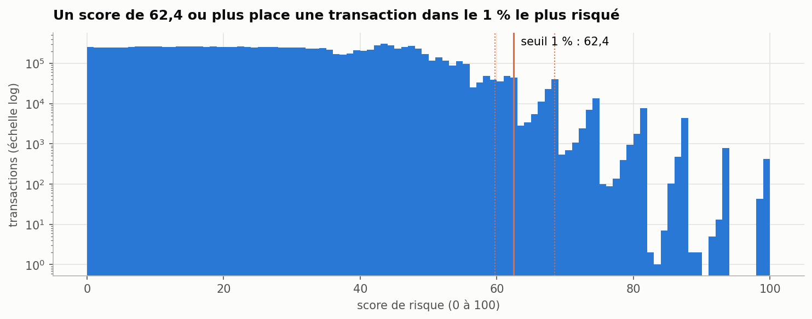

# P7-03 : Construire le score de risque

## Pourquoi cette étape ?

Les règles et Isolation Forest donnent deux avis différents. Un seul score de 0 à 100 les réunit, permet de trier les transactions et de fixer un seuil : on contrôle les transactions au-dessus.

Le critère de fin du ticket est : **score et seuil documentés**.

## Où est le code ?

- `src/detection.py` : `risk_score` et `threshold_for_share`.
- `notebooks/07_detection_anomalies.ipynb` : section P7-03.

## Le calcul

```python
RULE_POINTS_CAP = 8
RULE_WEIGHT = 0.5

def risk_score(rule_points, anomaly):
    rule_part = np.minimum(np.asarray(rule_points, dtype=float), RULE_POINTS_CAP) / RULE_POINTS_CAP
    anomaly_part = pd.Series(anomaly).rank(pct=True).to_numpy()
    return np.round(100 * (RULE_WEIGHT * rule_part + (1 - RULE_WEIGHT) * anomaly_part), 3)
```

**Score = 100 × (0,5 × partie règles + 0,5 × partie anomalies)**

| Partie | Calcul | Valeur |
| --- | --- | --- |
| Règles | Points des règles déclenchées (P7-01), plafonnés à 8, divisés par 8 | de 0 à 1 |
| Anomalies | Rang de la transaction selon le score d'Isolation Forest (P7-02) : 0,99 veut dire plus atypique que 99 % des transactions | de 0 à 1 |

Pourquoi le rang et non le score brut ? Le score d'Isolation Forest est serré (de 0,339 à 0,791). Le rang le met sur la même échelle que la partie règles.

Pourquoi un plafond de 8 points ? Au-delà, une transaction est déjà au maximum de la partie règles : cumuler encore des signaux faibles ne doit pas la faire monter.

## Le seuil

**Seuil retenu : le 1 % des transactions les plus risquées**, soit un score de **62,42 ou plus**. La validation (P7-04) compare aussi 0,5 % et 2 %.

## Résultats obtenus

| Mesure | Score |
| --- | --- |
| Médiane | 26,04 |
| Quantile 90 % | 48,61 |
| Quantile 99 % (seuil) | 62,42 |
| Quantile 99,5 % | 68,42 |
| Quantile 99,9 % | 81,11 |
| Maximum | 100,00 |

133 075 transactions sont signalées au seuil de 1 %.



La partie anomalies donne au plus 50 points : sans règle déclenchée, une transaction ne peut pas atteindre le seuil. Chaque transaction signalée a donc une raison écrite (P7-07).

**Critère de fin validé.**
