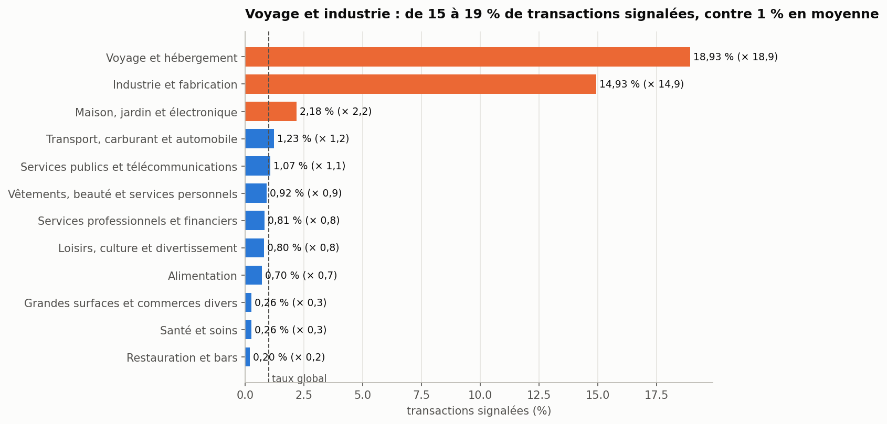
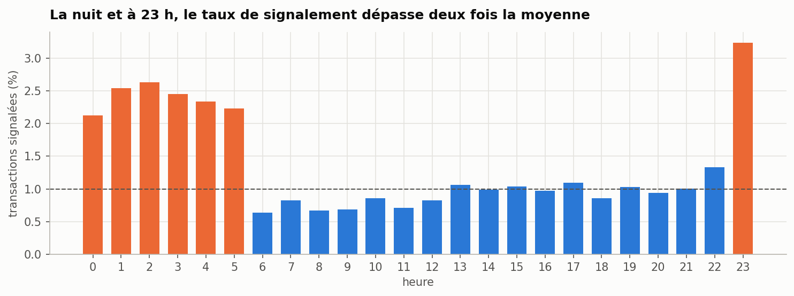

# P7-06 : Identifier les caractéristiques liées au risque (Q4)

## Pourquoi cette étape ?

Q4 demande quelles caractéristiques sont liées à un risque plus élevé. Le taux de signalement (seuil de 1 %) par groupe montre où se concentrent les transactions à contrôler.

Le critère de fin du ticket est : **tableau des taux et graphique**.

## Où est le code ?

`notebooks/07_detection_anomalies.ipynb`, section P7-06, avec `rate_table` de `src/comparisons.py`. Le **rapport** compare chaque taux au taux global de 1 % : 2 veut dire deux fois plus de signalements que la moyenne.

## Résultats obtenus

| Caractéristique | Groupe | Taux de signalement | Rapport |
| --- | --- | --- | --- |
| Lieu | À l'étranger | 19,437 % | 19,43 |
| | En ligne | 2,556 % | 2,56 |
| | Sur place aux États-Unis | 0,650 % | 0,65 |
| Canal | En ligne | 2,561 % | 2,56 |
| | Bande magnétique | 0,861 % | 0,86 |
| | Puce | 0,694 % | 0,69 |
| Profil | Acheteurs en ligne très actifs | 1,327 % | 1,33 |
| | Clients aisés et voyageurs | 1,212 % | 1,21 |
| | Clients sans dette | 0,804 % | 0,80 |
| | Clients courants | 0,794 % | 0,79 |
| Type de carte | Crédit | 1,169 % | 1,17 |
| | Débit | 0,969 % | 0,97 |
| | Prépayée | 0,523 % | 0,52 |
| Marque | Amex | 1,423 % | 1,42 |
| | Discover | 1,021 % | 1,02 |
| | Mastercard | 0,991 % | 0,99 |
| | Visa | 0,940 % | 0,94 |
| Heure | De 0 h à 5 h | de 2,124 % à 2,634 % | de 2,12 à 2,63 |
| | 23 h | 3,232 % | 3,23 |

| Famille | Taux | Rapport |
| --- | --- | --- |
| Voyage et hébergement | 18,933 % | 18,93 |
| Industrie et fabrication | 14,926 % | 14,92 |
| Maison, jardin et électronique | 2,178 % | 2,18 |
| Transport, carburant et automobile | 1,233 % | 1,23 |
| Services publics et télécommunications | 1,066 % | 1,07 |
| Vêtements, beauté et services personnels | 0,916 % | 0,92 |
| Services professionnels et financiers | 0,813 % | 0,81 |
| Loisirs, culture et divertissement | 0,798 % | 0,80 |
| Alimentation | 0,702 % | 0,70 |
| Grandes surfaces et commerces divers | 0,264 % | 0,26 |
| Santé et soins | 0,260 % | 0,26 |
| Restauration et bars | 0,201 % | 0,20 |

**Critère de fin validé.**

## Réponse à Q4

- **Les caractéristiques les plus liées au risque** : l'achat à l'étranger (19 fois le taux global), les familles voyage (19 fois) et industrie (15 fois), l'achat en ligne (2,6 fois) et la nuit (plus de 2 fois de 0 h à 5 h, 3,2 fois à 23 h).
- **Les moins risquées** : la restauration, la santé et les grandes surfaces (environ 0,2 fois), l'achat par puce (0,69 fois).
- **Les profils et les cartes comptent peu** : les taux vont de 0,52 à 1,42 fois le taux global.

## Prudence

- L'étranger, le canal en ligne et la nuit sont aussi des règles du score (R07, R10, R09) et des variables d'Isolation Forest. Une partie de leur taux élevé vient donc de la construction du score. Les familles, les profils et les cartes ne servent pas au score : leurs écarts sont des résultats.
- Voyage et industrie ont les achats les plus chers (P6-05) : les règles de montant inhabituel (R03) et la partie anomalies y signalent plus souvent.
- Les informations des cartes (type, marque) datent de février 2020 (P2-12) : la carte utilisée en 2010 pouvait être différente.
