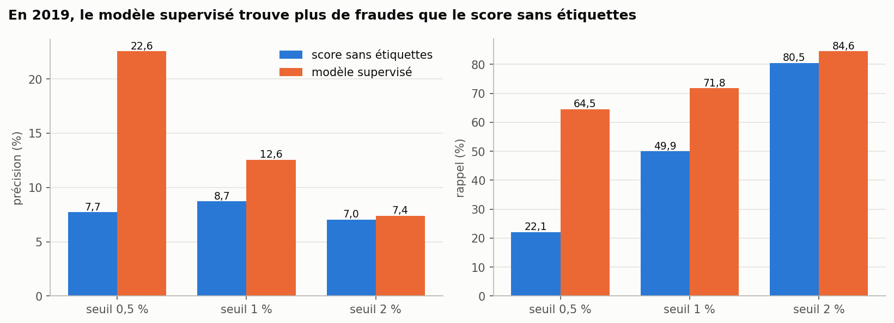

# P7-08 : Modèle supervisé (variante avec étiquettes de fraude)

## Pourquoi cette étape ?

L'enseignant a ajouté des étiquettes de fraude pour 67 % des transactions (P2-17). Avec elles, un modèle peut apprendre directement à quoi ressemble une fraude. On compare ce modèle au score sans étiquettes, sur des données qu'aucun des deux n'a vues.

Le critère de fin du ticket est : **résultats comparés et commentés**.

## Où est le code ?

- `src/detection.py` : `SUPERVISED_FEATURES`, `supervised_matrix`, `training_rows`, `train_supervised`, `precision_recall_at_shares` et `average_precision`.
- `notebooks/07_detection_anomalies.ipynb` : section P7-08.

## La méthode

| Élément | Choix |
| --- | --- |
| Apprentissage | Transactions étiquetées de 2010 à 2018 : 8 137 624 transactions, 11 972 fraudes |
| Test | Transactions étiquetées de 2019 : 777 339 transactions, 1 360 fraudes (0,175 %) |
| Modèle | Gradient boosting (`HistGradientBoostingClassifier`, 300 arbres) |
| Variables | Les 12 variables d'Isolation Forest, plus la nuit, le week-end, le jour, le montant rond, la validité de la carte, la famille de commerçants et le canal |
| Déséquilibre | Toutes les fraudes et 20 % des autres transactions (1 636 409 lignes), avec `class_weight="balanced"` |
| Exclus | Le genre et l'âge (choix éthique, P9-15) |

Couper par année (et non au hasard) simule la vraie utilisation : on apprend sur le passé, on prédit l'année suivante.

**Précision** : part de vraies fraudes parmi les transactions signalées. **Rappel** : part des fraudes qui sont signalées. L'**aire sous la courbe précision-rappel** résume les deux pour tous les seuils (1 = parfait ; un tri au hasard vaut le taux de fraude, 0,00175 ici).

## Résultats obtenus (transactions étiquetées de 2019)

| Seuil | Modèle : précision | Modèle : rappel | Score : précision | Score : rappel |
| --- | --- | --- | --- | --- |
| 0,5 % (3 887 signalées) | 22,56 % | 64,49 % | 7,72 % | 22,06 % |
| 1 % (7 774 signalées) | 12,55 % | 71,76 % | 8,73 % | 49,93 % |
| 2 % (15 547 signalées) | 7,40 % | 84,56 % | 7,04 % | 80,51 % |

Aire sous la courbe précision-rappel : **0,438 pour le modèle**, 0,102 pour le score sans étiquettes.

Variables les plus utiles au modèle (baisse de l'aire quand on mélange la variable) :

| Variable | Baisse |
| --- | --- |
| Achat à l'étranger | 0,5984 |
| Famille de commerçants | 0,5802 |
| Canal | 0,5720 |
| Heure | 0,2825 |
| Montant (logarithme) | 0,0885 |
| Premier achat chez ce commerçant | 0,0653 |
| Rapport au montant habituel | 0,0536 |

Les rafales (0,0172) et les échecs d'authentification récents (-0,0012) n'aident presque pas le modèle.

**Critère de fin validé.**

## Commentaire

- **Le modèle supervisé est nettement meilleur aux seuils bas** : au seuil de 0,5 %, il trouve près de trois fois plus de fraudes que le score (rappel de 64,49 % contre 22,06 %), avec une précision trois fois plus haute.
- **Au seuil de 2 %, les deux se rejoignent** : le score sans étiquettes trouve 80,51 % des fraudes, contre 84,56 %.
- **Les deux approches ne voient pas la fraude de la même façon** : le modèle s'appuie sur le lieu, la famille, le canal et l'heure ; le score donne beaucoup de poids aux rafales, qui n'aident pas à trouver les fraudes.
- **Limite** : le modèle n'est possible que parce que des étiquettes existent. Il faut les mettre à jour pour suivre les nouvelles formes de fraude.
