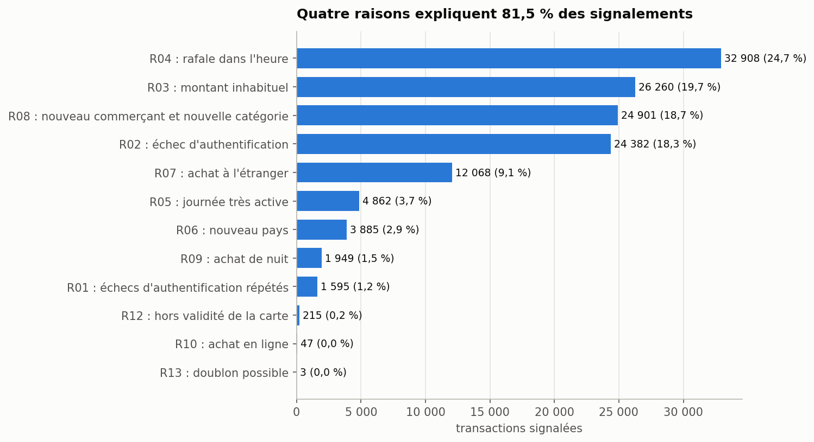
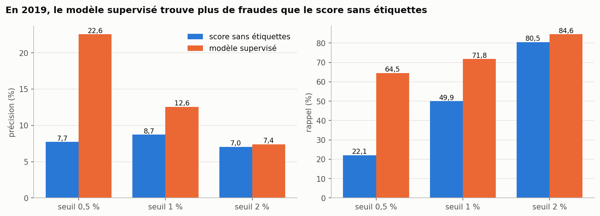

# P7-09 : Visuels clés de la détection (Q3, Q4)

Statut : à relire par un autre membre (critère de fin de P7-09).

Les visuels sont créés par `notebooks/07_detection_anomalies.ipynb` et enregistrés dans `docs/figures/`. Chacun annonce son message dans son titre et suit la charte (P1-10) : orange pour ce qui dépasse deux fois la moyenne, bleu pour le reste.

| Visuel | Message (titre) | Ticket |
| --- | --- | --- |
| `P7-03_score_risque.png` | Un score de 62,4 ou plus place une transaction dans le 1 % le plus risqué | P7-03 |
| `P7-06_signalement_familles.png` | Voyage et industrie : de 15 à 19 % de transactions signalées, contre 1 % en moyenne | P7-06 (Q4) |
| `P7-06_signalement_heures.png` | La nuit et à 23 h, le taux de signalement dépasse deux fois la moyenne | P7-06 (Q4) |
| `P7-09_raisons_signalement.png` | Quatre raisons expliquent 81,5 % des signalements | P7-07 (Q3, Q5) |
| `P7-09_precision_rappel.png` | En 2019, le modèle supervisé trouve plus de fraudes que le score sans étiquettes | P7-08 et P7-11 |

## Liste de contrôle pour la relecture

- [ ] Le titre dit le message, et le message est vrai d'après les chiffres du notebook.
- [ ] Orange seulement pour ce qui ressort, bleu pour le reste.
- [ ] Axes titrés, nombres à la française.
- [ ] Le graphique précision et rappel compare les mêmes transactions (2019) et les mêmes seuils.
