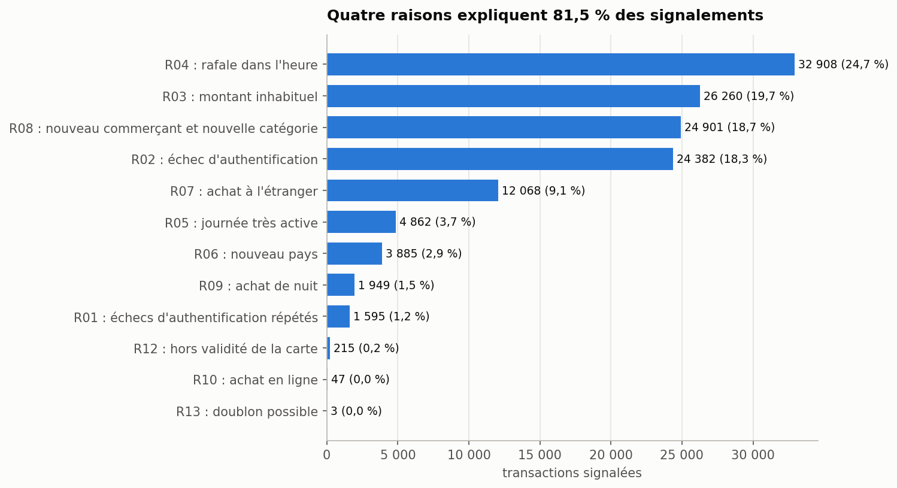
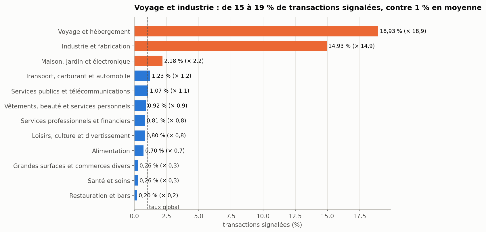
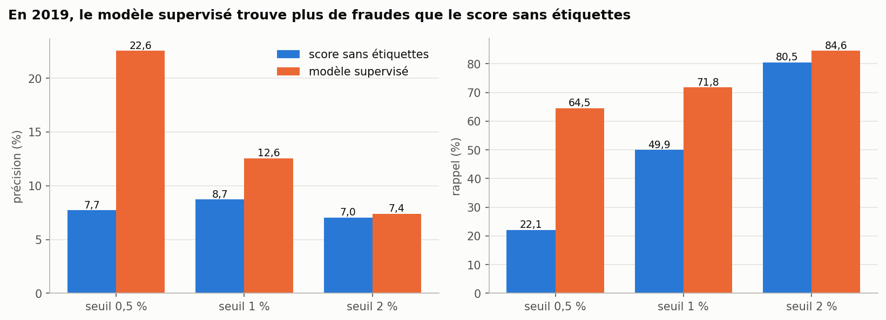

# P7-10 : Section « Détection » du rapport (Q3, Q4, Q5)

Statut : à relire par un autre membre (critère de fin de P7-10). Tous les chiffres viennent de `notebooks/07_detection_anomalies.ipynb`.

## Questions

- Q3 : qu'est-ce qui distingue les transactions frauduleuses des autres ?
- Q4 : quelles caractéristiques sont liées à un risque plus élevé ?
- Q5 : quels indicateurs permettent de repérer les comportements inhabituels ?

Les quatre fichiers de départ n'ont pas de colonne de fraude. La détection est donc faite en deux variantes : **sans étiquettes** (score de risque) puis **avec étiquettes**, grâce au fichier `fraud_labels.json` ajouté par l'enseignant (67 % des transactions, 0,150 % de fraudes).

## Méthode du score

1. **Règles métier (P7-01).** 13 règles, une par signal du catalogue des indicateurs (P4-09). Chacune donne 1, 2 ou 3 points. Les seuils viennent des distributions de la phase 4, sans les étiquettes.
2. **Anomalies (P7-02).** Isolation Forest note chaque transaction selon ses variables de comportement : plus elle est facile à isoler, plus elle est atypique.
3. **Score (P7-03).** Score = 100 × (0,5 × points des règles plafonnés à 8, ramenés entre 0 et 1 + 0,5 × rang d'anomalie). Seuil retenu : le 1 % le plus risqué, soit un score de 62,42 ou plus (133 075 transactions).

## Validation (P7-04)

- **Charge de travail** : 37,1 signalements par jour au seuil de 1 % (18,5 à 0,5 %, 74,1 à 2 %).
- **Stabilité** : le taux de signalement baisse de 1,683 % en 2010 à 0,825 % en 2019. Le seuil doit être recalculé chaque année.
- **Revue manuelle** de 50 transactions : 21 plausibles, 18 douteuses, 11 faux positifs probables, tous dus aux rafales (R04).

## Résultats

### Q5 : les indicateurs qui repèrent l'inhabituel

Quatre raisons expliquent 81,5 % des signalements : rafales (R04), montant inhabituel (R03), nouveau commerçant dans une nouvelle catégorie (R08) et échec d'authentification (R02). La liste priorisée (P7-07) donne pour chaque transaction son rang, son score et sa raison.

### Q3 : ce qui distingue les transactions signalées

Sur les variables qui n'ont pas servi au score, 11 tests sur 12 sont significatifs, mais seule la famille de commerçants a un effet réel (faible : V de Cramér de 0,193). Les clients et les cartes des transactions signalées ressemblent aux autres : âge, genre, revenu, score de crédit ont des effets négligeables.

### Q4 : les caractéristiques liées au risque

- Achat à l'étranger : 19,437 % de transactions signalées, 19 fois le taux global.
- Voyage et hébergement (18,933 %) et industrie et fabrication (14,926 %).
- Achat en ligne (2,561 %) et nuit (de 2,124 % à 2,634 % entre 0 h et 5 h, 3,232 % à 23 h).
- Les moins risquées : restauration (0,201 %), santé (0,260 %), grandes surfaces (0,264 %), puce (0,694 %).

### Variante avec étiquettes (P7-08 et P7-11)

| | Précision au seuil de 1 % | Rappel au seuil de 1 % |
| --- | --- | --- |
| Score sans étiquettes, sur toutes les transactions étiquetées | 3,57 % | 23,93 % |
| Score sans étiquettes, en 2019 | 8,73 % | 49,93 % |
| Modèle supervisé, en 2019 | 12,55 % | 71,76 % |

- Le score signale 23,9 fois plus de fraudes que le hasard, mais il rate environ trois fraudes sur quatre sur toute la période.
- Le modèle supervisé, appris sur 2010 à 2018 et testé sur 2019, fait mieux, surtout aux seuils bas (aire précision-rappel de 0,438 contre 0,102).
- Les meilleures règles sont le nouveau pays (13,81 % de précision), le nouveau commerçant dans une nouvelle catégorie (8,47 %) et l'achat à l'étranger (6,67 %). Les rafales ne signalent pas la fraude (0,04 % pour R04).

## Limites d'une approche sans colonne de fraude

- **On mesure l'inhabituel, pas la fraude.** Un client qui voyage ou change d'habitudes est signalé sans être fraudé : la plupart des signalements sont des fausses alertes (précision de 3,57 % au seuil de 1 %).
- **Les seuils et les poids sont des choix d'experts**, à défaut d'étiquettes pour les régler. Une règle peut sembler logique et ne rien apporter (rafales).
- **Résultats circulaires** : les caractéristiques qui servent au score (étranger, en ligne, nuit) ont mécaniquement plus de signalements. Seules les variables hors du score (familles, profils, cartes) donnent une conclusion indépendante.
- **Les étiquettes ne couvrent que 67 % des transactions**, et le taux de fraude varie beaucoup selon l'année (de 0,004 % en 2011 à 0,309 % en 2010, P2-17).
- **Les informations des clients et des cartes datent de février 2020** (P2-12).
