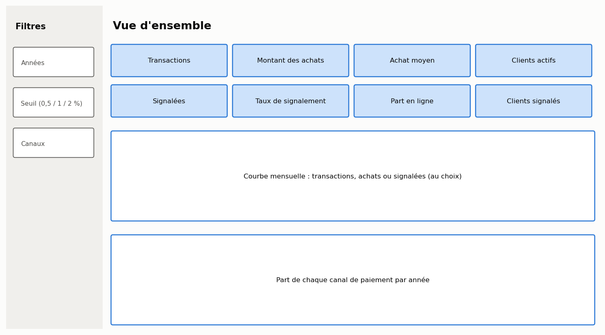
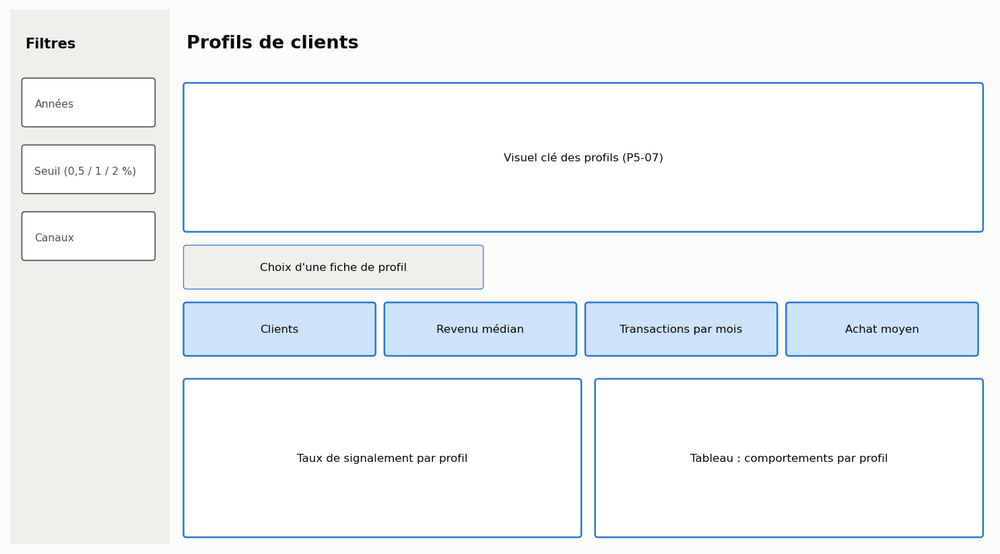
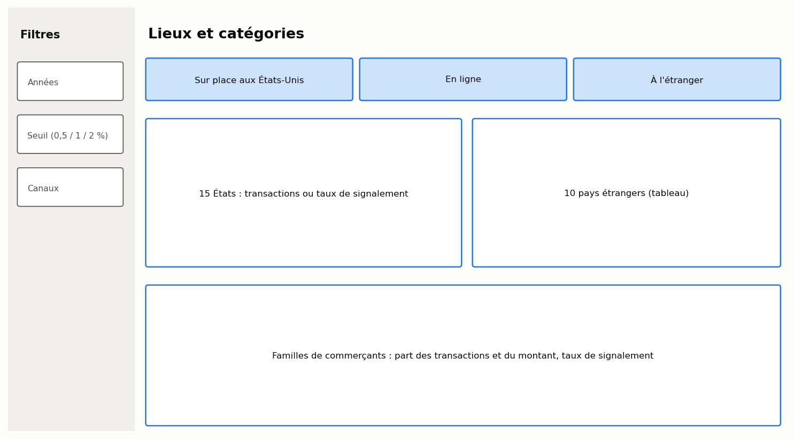
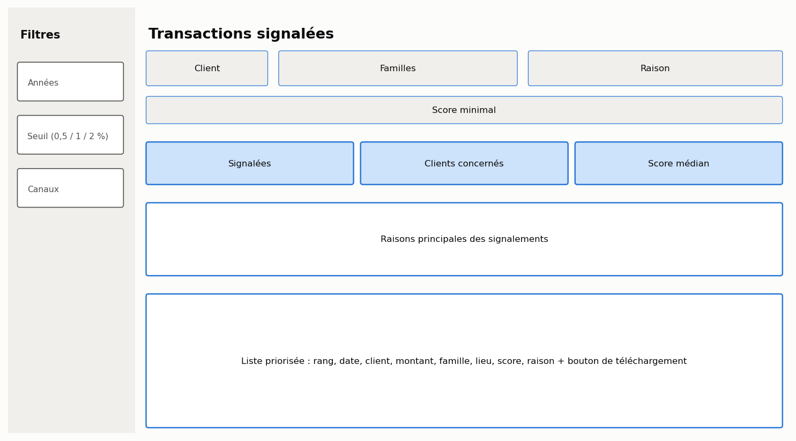

# P8-02 : Choisir l'outil et dessiner la maquette

Statut : à valider par l'équipe (critère de fin de P8-02).

## Pourquoi cette étape ?

Le choix de l'outil décide de ce que l'on peut faire (filtres, liste filtrée, téléchargement) et de qui peut l'ouvrir. La maquette fixe le contenu de chaque page avant d'écrire le code : on discute plus vite d'un dessin que d'une application.

Le critère de fin du ticket est : **maquette validée par l'équipe**.

## Les outils comparés

| Critère                                      | Streamlit                                       | Power BI                            | Tableau Public                                 |
| -------------------------------------------- | ----------------------------------------------- | ----------------------------------- | ---------------------------------------------- |
| Coût                                         | Gratuit                                         | Gratuit sur Windows, partage payant | Gratuit, mais publication en ligne obligatoire |
| Lit nos fichiers Parquet                     | Oui, avec le même code Python que les notebooks | Avec un connecteur                  | Non (export CSV nécessaire)                    |
| Versionné dans Git avec le reste du projet   | Oui (fichiers `.py`)                            | Non (fichier binaire `.pbix`)       | Non                                            |
| Calculs vérifiables dans un notebook (P8-08) | Oui : les mêmes fonctions                       | Non                                 | Non                                            |
| Fonctionne sur Windows et Mac                | Oui                                             | Windows seulement                   | Oui                                            |
| Données confidentielles gardées en local     | Oui                                             | Oui                                 | Non (publication publique)                     |

**Choix : Streamlit.** Le code du tableau de bord est en Python, comme le reste du projet. Les chiffres affichés sont calculés par des fonctions que le notebook 08 réutilise pour la vérification (P8-08). Les données restent sur l'ordinateur de chacun.

## Les maquettes

Une maquette par page, avec les couleurs de la charte (P1-10). Les filtres communs sont dans la barre de gauche. Les images sont créées par `notebooks/08_tableau_de_bord.ipynb` (section P8-02).

### Vue d'ensemble

### Profils de clients

### Lieux et catégories

### Transactions signalées

## Ce que cette étape ne fait PAS

- Elle ne prépare pas les données : c'est P8-03.
- Elle ne code pas les pages : ce sont P8-04 à P8-07.
