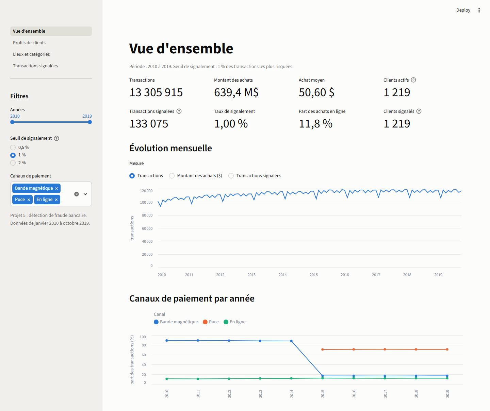

# P8-04 : Créer la page « Vue d'ensemble »

## Pourquoi cette page ?

Le responsable de la fraude a besoin d'un coup d'œil sur l'activité et sur le nombre de transactions à contrôler. Cette page répond aux questions « combien ? » et « est-ce que ça change ? ».

Contenu demandé dans Jira : volumes, montants, tendances, canaux de paiement. Critère de fin : **page terminée**.

## Où est le code ?

- `dashboard/pages.py` : la fonction de la page.
- `dashboard/calculs.py` : les calculs des chiffres affichés (sans Streamlit, réutilisés par la vérification P8-08).
- Les filtres communs (années, seuil, canaux) sont dans `dashboard/app.py`.

## Ce que la page affiche

| Élément          | Contenu                                                                                                                                                | Fonction de `dashboard/calculs.py` |
| ---------------- | ------------------------------------------------------------------------------------------------------------------------------------------------------ | ---------------------------------- |
| 8 chiffres clés  | Transactions, montant des achats, achat moyen, clients actifs, transactions signalées, taux de signalement, part des achats en ligne, clients signalés | `indicateurs`                      |
| Courbe mensuelle | Transactions, montant des achats ou transactions signalées, au choix                                                                                   | `tendance_mensuelle`               |
| Canaux par année | Part de la bande magnétique, de la puce et des achats en ligne                                                                                         | `parts_canaux`                     |

Chaque graphique a une info-bulle au survol et suit la charte (P1-10). Les nombres sont à la française.

## Capture d'écran

Avec les filtres par défaut : 13 305 915 transactions, 639,4 M$ d'achats, achat moyen de 50,60 $, 1 219 clients actifs, 133 075 transactions signalées (1,00 %), 11,8 % d'achats en ligne.

## Résultat

La page s'affiche sans erreur avec les filtres par défaut (test automatique, `notebooks/08_tableau_de_bord.ipynb`, section P8-04 à P8-07). **Critère de fin validé.**
