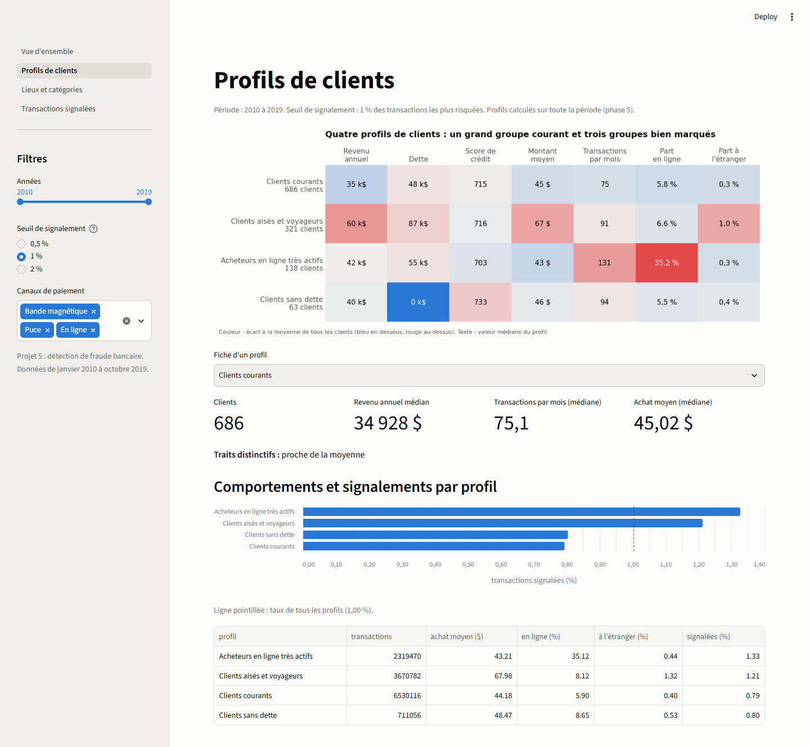

# P8-05 : Créer la page « Profils de clients »

## Pourquoi cette page ?

L'équipe relation client veut comprendre qui sont les clients, et le responsable de la fraude veut savoir si un profil est plus exposé.

Contenu demandé dans Jira : profils, tailles et comportements. Critère de fin : **page terminée**.

## Où est le code ?

- `dashboard/pages.py` : la fonction de la page.
- `dashboard/calculs.py` : les calculs des chiffres affichés (sans Streamlit, réutilisés par la vérification P8-08).
- Les filtres communs (années, seuil, canaux) sont dans `dashboard/app.py`.

## Ce que la page affiche

| Élément                        | Contenu                                                                        | Source                                   |
| ------------------------------ | ------------------------------------------------------------------------------ | ---------------------------------------- |
| Visuel des profils             | L'image de P5-07                                                               | `docs/figures/P5-07_profils_clients.png` |
| Fiche d'un profil              | Clients, revenu médian, transactions par mois, achat moyen, traits distinctifs | table `profils` (P5-05)                  |
| Taux de signalement par profil | Graphique en barres, avec le taux de tous les profils en pointillé             | `resume_profils`                         |
| Tableau des comportements      | Transactions, achat moyen, parts en ligne et à l'étranger, taux de signalement | `resume_profils`                         |

Chaque graphique a une info-bulle au survol et suit la charte (P1-10). Les nombres sont à la française.

## Capture d'écran

Les profils sont présentés par groupe : aucune donnée financière d'un client précis n'est affichée.

## Résultat

La page s'affiche sans erreur avec les filtres par défaut (test automatique, `notebooks/08_tableau_de_bord.ipynb`, section P8-04 à P8-07). **Critère de fin validé.**
