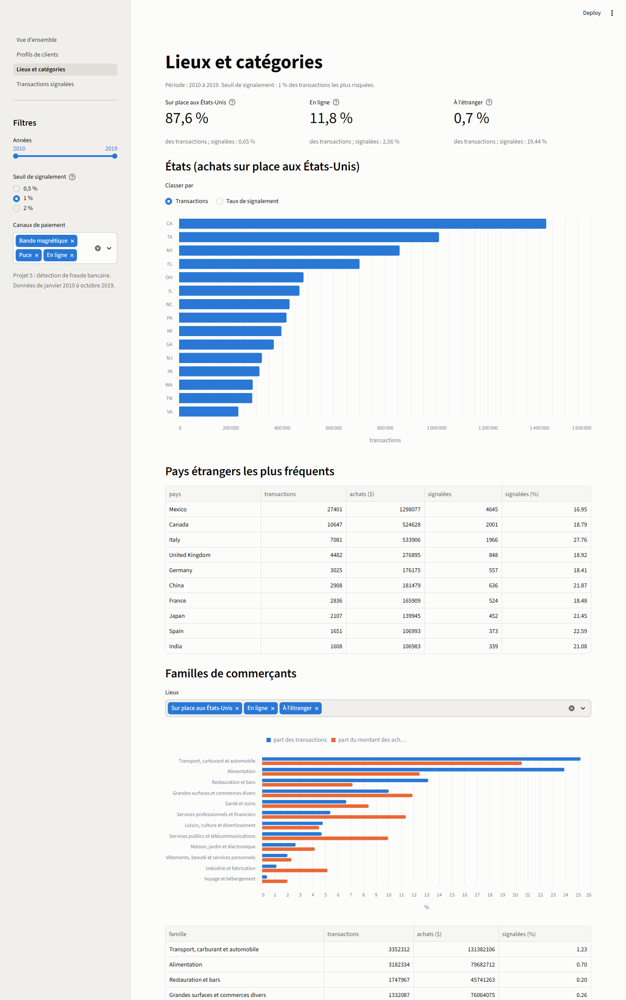

# P8-06 : Créer la page « Lieux et catégories »

## Pourquoi cette page ?

Où les clients achètent-ils, dans quels commerces, et où les signalements se concentrent-ils ? Cette page répond à Q6 et à une partie de Q4.

Contenu demandé dans Jira : états et pays, achats en ligne, familles de commerçants. Critère de fin : **page terminée**.

## Où est le code ?

- `dashboard/pages.py` : la fonction de la page.
- `dashboard/calculs.py` : les calculs des chiffres affichés (sans Streamlit, réutilisés par la vérification P8-08).
- Les filtres communs (années, seuil, canaux) sont dans `dashboard/app.py`.

## Ce que la page affiche

| Élément                 | Contenu                                                                                                 | Fonction                        |
| ----------------------- | ------------------------------------------------------------------------------------------------------- | ------------------------------- |
| 3 chiffres              | Part des transactions sur place aux États-Unis, en ligne et à l'étranger, avec leur taux de signalement | `resume_lieux`                  |
| 15 États                | Classés par nombre de transactions ou par taux de signalement (au choix)                                | `classement(..., "etats", ...)` |
| 10 pays étrangers       | Transactions, achats et taux de signalement                                                             | `classement(..., "pays", ...)`  |
| Familles de commerçants | Part des transactions et du montant (graphique), taux de signalement (tableau), filtre par lieu         | `resume_familles`               |

Chaque graphique a une info-bulle au survol et suit la charte (P1-10). Les nombres sont à la française.

## Capture d'écran

Avec les filtres par défaut : 87,6 % des transactions sur place aux États-Unis, 11,8 % en ligne et 0,7 % à l'étranger.

## Résultat

La page s'affiche sans erreur avec les filtres par défaut (test automatique, `notebooks/08_tableau_de_bord.ipynb`, section P8-04 à P8-07). **Critère de fin validé.**
