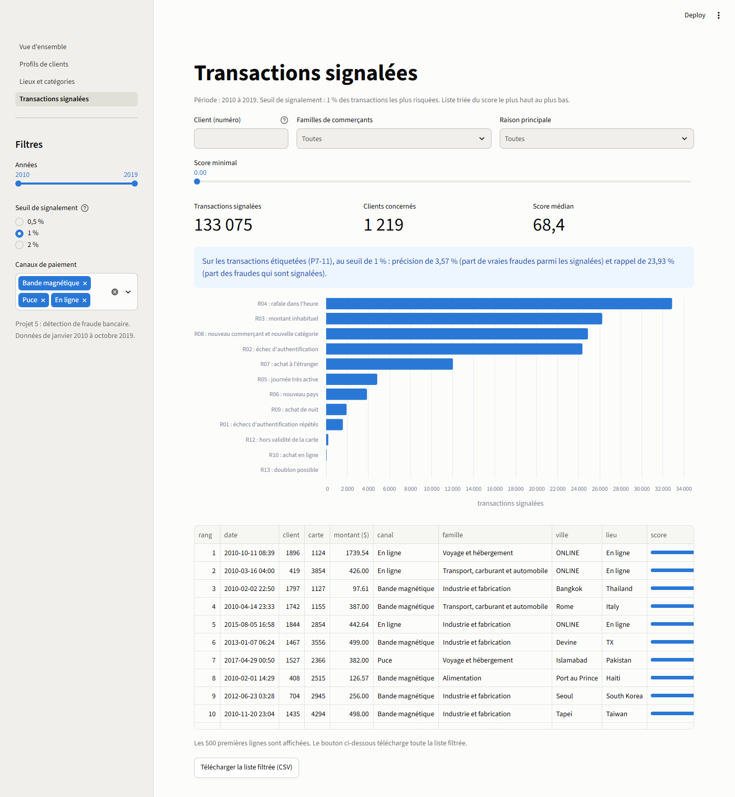

# P8-07 : Créer la page « Transactions signalées »

## Pourquoi cette page ?

C'est la page de travail de l'analyste : la liste des transactions à contrôler, de la plus risquée à la moins risquée, avec la raison de chaque signalement.

Contenu demandé dans Jira : liste priorisée, filtres, raisons du signalement. Critère de fin : **page terminée**.

## Où est le code ?

- `dashboard/pages.py` : la fonction de la page.
- `dashboard/calculs.py` : les calculs des chiffres affichés (sans Streamlit, réutilisés par la vérification P8-08).
- Les filtres communs (années, seuil, canaux) sont dans `dashboard/app.py`.

## Ce que la page affiche

| Élément            | Contenu                                                                                                   | Fonction           |
| ------------------ | --------------------------------------------------------------------------------------------------------- | ------------------ |
| Filtres de la page | Numéro de client, familles de commerçants, raison principale, score minimal                               | `liste_signalee`   |
| 3 chiffres         | Transactions signalées, clients concernés, score médian                                                   |                    |
| Encadré            | Précision et rappel du seuil choisi, mesurés sur les transactions étiquetées (P7-11)                      | table `evaluation` |
| Raisons            | Nombre de transactions par raison principale (libellés courts)                                            |                    |
| Liste              | Les 500 premières lignes : rang, date, client, carte, montant, canal, famille, ville, lieu, score, raison |                    |
| Téléchargement     | Toute la liste filtrée, en CSV                                                                            |                    |

Chaque graphique a une info-bulle au survol et suit la charte (P1-10). Les nombres sont à la française.

## Capture d'écran

Avec les filtres par défaut : 133 075 transactions signalées, 1 219 clients concernés, score médian de 68,4. Le scénario « trouver les 10 transactions les plus risquées d'un client » se fait avec le filtre « Client » (vérifié en P8-08).

## Résultat

La page s'affiche sans erreur avec les filtres par défaut (test automatique, `notebooks/08_tableau_de_bord.ipynb`, section P8-04 à P8-07). **Critère de fin validé.**
